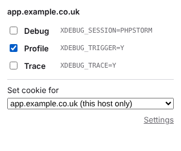
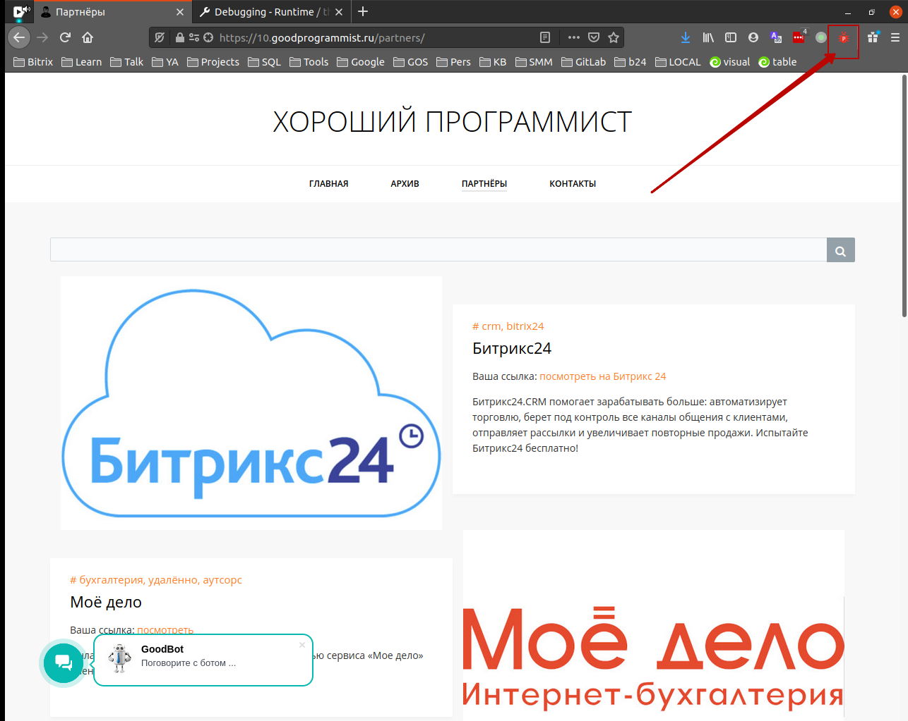
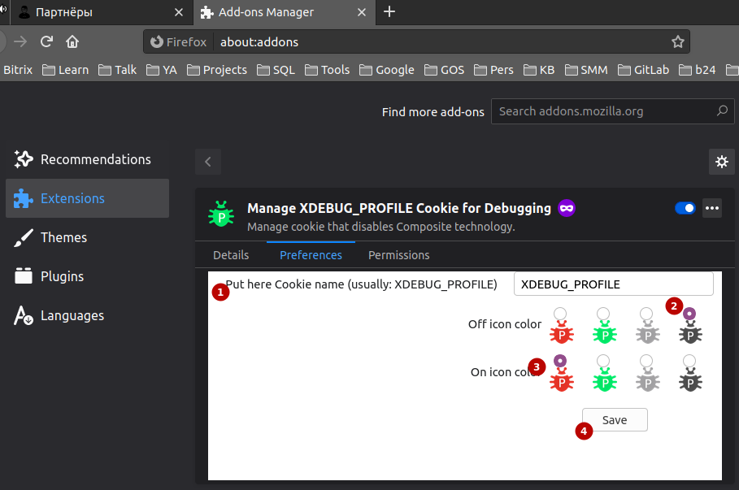
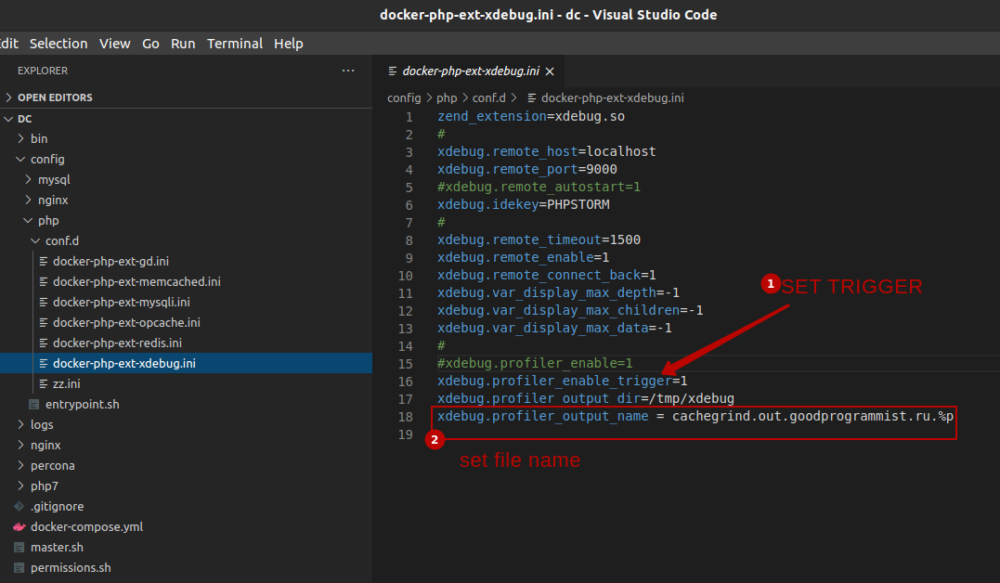
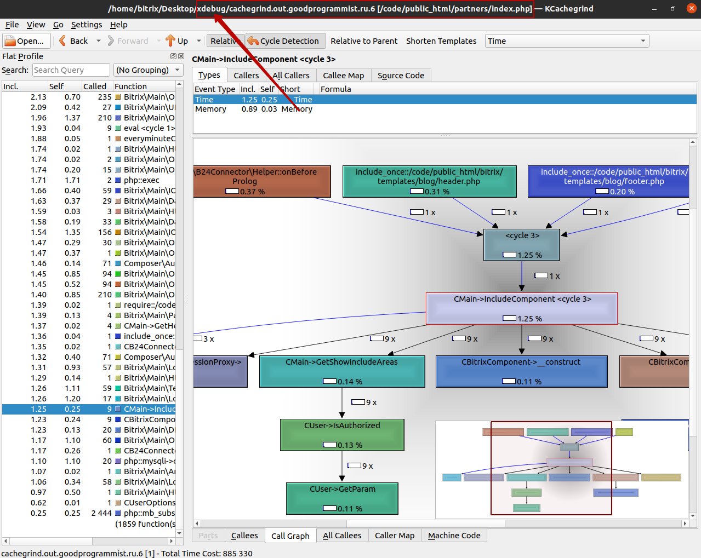
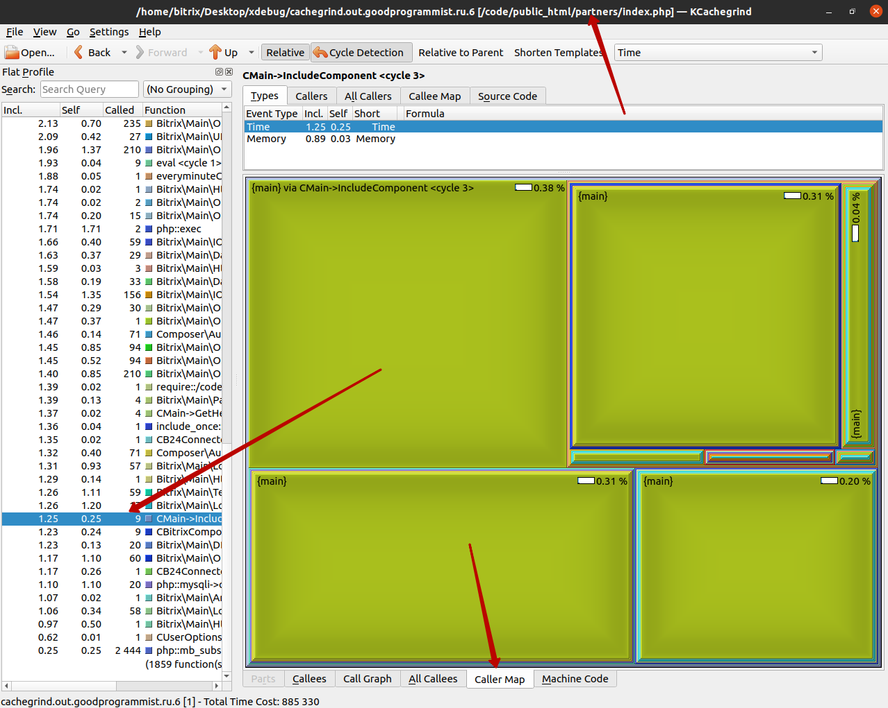

# XDEBUG_PROFILE (cookie trigger)
Firefox addon for setting XDEBUG_PROFILE cookie

**Install:** [Firefox Add-ons (AMO)](https://addons.mozilla.org/firefox/addon/xdebug_profile-cookie-trigger/) · Chrome Web Store — under review

Now works in **Firefox 140+**, **Firefox for Android 142+** and **Chrome / Chromium 121+** (one Manifest V3 codebase).
On Android there are no keyboard shortcuts (the browser has no commands API); every browser API is
checked before use, so missing APIs only switch off the related feature.

The toolbar popup toggles Xdebug trigger cookies for the current site:

| Trigger | Cookie (default) | Xdebug mode | Badge |
|---|---|---|---|
| Debug | `XDEBUG_SESSION=vsc` (IDE key) | `debug` | D |
| Profile | `XDEBUG_PROFILE=Y` | `profile` | P |
| Trace | `XDEBUG_TRACE=Y` | `trace` | T |

The cookie can be set for the current host only or for a parent domain with all
its subdomains (e.g. `.example.com` for `api.example.com` and `www.example.com`).
The choice is remembered per host.

Click the IDE name in the popup to set an own IDE key for the current site
(e.g. a project behind a DBGp proxy). Other sites keep the global key.

Interface languages: English, Russian, Kazakh (follows the browser language).

## Keyboard shortcuts

- `Alt+Shift+K` - open popup
- `Alt+Shift+F` - toggle profiler cookie
- `Alt+Shift+D` - toggle debugger cookie

(`Alt+Shift+P` and `Alt+Shift+X` are reserved by Chrome for tab groups.)
- toggle trace cookie - no default shortcut

Firefox: `about:addons` → gear → "Manage Extension Shortcuts".
Chrome: `chrome://extensions/shortcuts`.

## Installation from sources

Firefox: `about:debugging#/runtime/this-firefox` → "Load Temporary Add-on…" → select `manifest.json`.
Firefox may treat host permissions as optional: if the popup shows "Grant access", click it.

Chrome: `chrome://extensions` → enable "Developer mode" → "Load unpacked" → select the repository folder.

Package: `npm install && npm run build` → `web-ext-artifacts/*.zip` (works for both browsers).

## Development

```sh
npm install
npm run lint          # web-ext lint
npm run test:unit     # no browser: API helpers, Firefox for Android-like environment
npm run test:chrome   # Playwright, Chromium (CHROMIUM_PATH can point to a custom binary)
npm run test:firefox  # Selenium + geckodriver, needs Firefox
                      # (FIREFOX_PATH / GECKODRIVER_PATH can point to custom binaries)
```

GitHub Actions run lint and both browser tests on every push and pull request.

## Release

Bump `version` in `manifest.json`, merge to `master`, then push a tag with the same version:

```sh
git tag v1.1 && git push origin v1.1
```

The Release workflow checks the version, builds the zip and creates a GitHub release with it.
Store listing texts, privacy policy and images are in [`store/`](store/README.md).

## Server setup (php.ini)

Xdebug 3:

```ini
xdebug.mode = debug,profile,trace
xdebug.start_with_request = trigger
xdebug.output_dir = /tmp/xdebug
; optional: if set, cookie values in addon options must be the same
; xdebug.trigger_value = Y
```

Xdebug 2:

```ini
xdebug.remote_enable = 1
xdebug.profiler_enable_trigger = 1
xdebug.trace_enable_trigger = 1
xdebug.profiler_output_dir = /tmp/xdebug
```

Open the generated `cachegrind.out.*` files in KCachegrind / QCachegrind.

## Options

- IDE for step debugging: the `XDEBUG_SESSION` value is passed to the IDE as IDE key.
  Presets: VS Code `vsc` (default, `php.debug.ideKey` of the PHP Debug extension),
  PhpStorm `PHPSTORM`, NetBeans `netbeans-xdebug`, Eclipse `XDEBUG_ECLIPSE`, MacGDBp `macgdbp`,
  or a custom key (e.g. `VSCODE`). Without DBGp proxy and `xdebug.trigger_value` any key works;
  with DBGp proxy it must match the key configured in your IDE.
  The options page asks to choose the IDE after installation;
- cookie name and value for every trigger (value must match one of `xdebug.trigger_value`
  values if it is set, since Xdebug 3.1 it can be a comma separated list);
- icon colors for "on" and "off" states.

After renaming a cookie in options, cookies with the old name/value are removed from all sites.

## Debug

All scripts log with the `[XDEBUG_PROFILE]` prefix (enable "Debug"/"Verbose" level in the console):

- Firefox: `about:debugging#/runtime/this-firefox` → this addon → "Inspect";
- Chrome: `chrome://extensions` → this addon → "service worker".

Popup can be opened in a regular tab for a given tab: `popup.html?tabId=N`.

## Files

- `common.js` - shared code (triggers, cookies, settings), used by all pages;
- `background.js` - icon, badge, shortcuts, sync with cookie/settings changes;
- `popup.html/js/css` - toolbar popup;
- `options.html/js/css` - settings page;
- `_locales/` - translations (en, ru, kk);
- `tests/` - browser tests, `store/` - store listing materials.

## Screenshots







